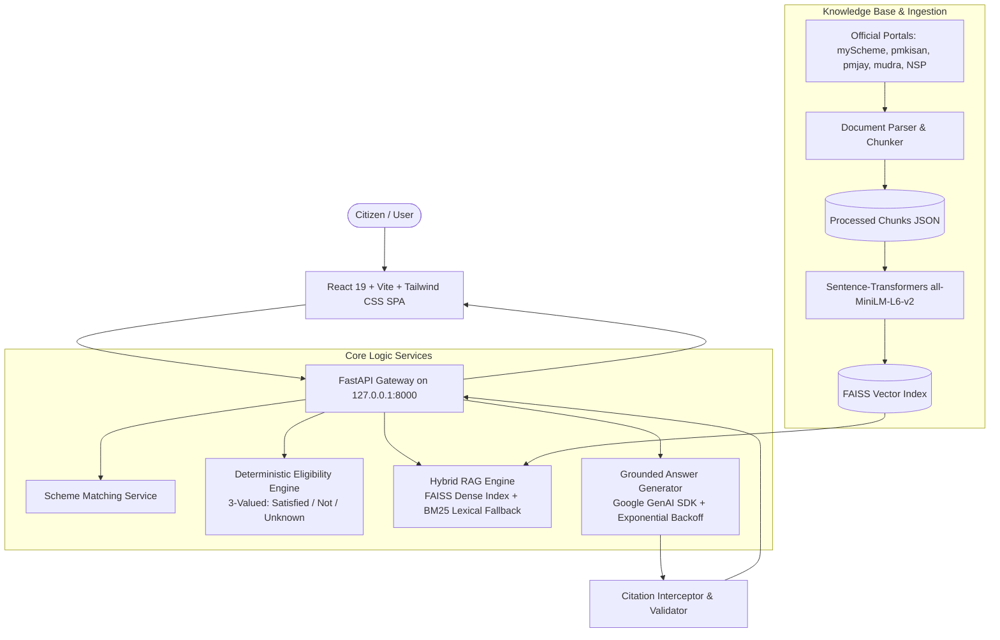

# JanSahayak AI (जनसहायक AI)
### Production-Quality Indian Government Scheme Navigator & Grounded AI Assistant

[](https://fastapi.tiangolo.com)
[](https://www.python.org/)
[](https://react.dev/)
[](https://tailwindcss.com/)
[](https://github.com/facebookresearch/faiss)
[](https://ai.google.dev/)
[](./tests)

**JanSahayak AI** is an intelligent, source-grounded civic navigator built to eliminate the awareness gap and confusion surrounding Indian welfare schemes. By marrying **FAISS dense semantic retrieval** with a **deterministic three-valued eligibility engine** (`satisfied`, `not_satisfied`, `unknown`), JanSahayak AI helps citizens discover verified Central and State government schemes, verify their qualification transparently without AI hallucinations, and prepare official application document checklists.

---

## 🏛️ Problem Statement

India hosts hundreds of welfare and financial assistance programs across Union Ministries and State Governments. However:
1. **Discovery Barrier:** Citizens do not know which schemes exist or how their specific profile (landholding, occupation, income) matches qualification criteria.
2. **LLM Hallucination Risk:** Standard AI chatbots hallucinate eligibility guidelines, fabricate deadlines, and invent non-existent rules.
3. **Application Bewilderment:** Citizens struggle to gather the exact official documents required before visiting designated government camps or portals.

JanSahayak AI solves this by strictly separating **probabilistic retrieval** from **deterministic eligibility evaluation**, grounding all answers in verified government gazettes and official portals.

---

## 🏗️ Architecture



---

## 🛠️ Technology Stack

| Layer | Technologies |
| :--- | :--- |
| **Backend & API** | Python 3.10, FastAPI, Uvicorn, Pydantic v2, Python-Dotenv |
| **Semantic Vector Search** | FAISS (`faiss-cpu`), Sentence Transformers (`all-MiniLM-L6-v2`), NumPy |
| **Generative AI** | Google GenAI Python SDK (`google-genai`), Exponential Backoff & Jitter, Model Fallback Cascade |
| **Frontend UI** | React 19, TypeScript, Vite 8, Tailwind CSS, Lucide React |
| **Document Processing** | PyPDF, BeautifulSoup4, Custom Paragraph-Aware Chunker |
| **Testing & Evaluation** | Pytest, FastAPI TestClient, HTTPX, Custom Retrieval Benchmark |

---

## 📚 Verified Schemes Knowledge Base

JanSahayak AI contains **8 thoroughly verified Indian welfare programs** with discrete eligibility rules and document checklists:

1. **PM-KISAN (Pradhan Mantri Kisan Samman Nidhi)** — *₹6,000/yr Direct Income Support for Cultivator Farmers* ([pmkisan.gov.in](https://pmkisan.gov.in/))
2. **AB-PMJAY (Ayushman Bharat Jan Arogya Yojana)** — *₹5,00,000/yr Cashless Hospitalization Assurance* ([pmjay.gov.in](https://pmjay.gov.in/))
3. **PMAY-U (Pradhan Mantri Awas Yojana - Urban)** — *Housing Subsidy for EWS/LIG families without a Pucca House* ([pmaymis.gov.in](https://pmaymis.gov.in/))
4. **PMMY (Pradhan Mantri Mudra Yojana)** — *Collateral-free micro-loans up to ₹10-20 Lakh for small enterprises* ([mudra.org.in](https://www.mudra.org.in/))
5. **NSP Post-Matric Scholarship for SC Students** — *100% Tuition Fee Waiver & Maintenance Allowance* ([scholarships.gov.in](https://scholarships.gov.in/))
6. **PM SVANidhi** — *Graduated working capital loans (₹10k to ₹50k) with 7% interest subsidy for Street Vendors* ([pmsvanidhi.mohua.gov.in](https://pmsvanidhi.mohua.gov.in/))
7. **Sukanya Samriddhi Yojana (SSY)** — *Triple-Tax-Free (EEE) sovereign small savings for girl child education* ([indiapost.gov.in](https://www.indiapost.gov.in/))
8. **Mukhyamantri Ladli Behna Yojana (MP)** — *₹1,250/month Direct DBT for resident women of Madhya Pradesh* ([cmladlibehna.mp.gov.in](https://cmladlibehna.mp.gov.in/))

---

## ⚡ Quickstart & Windows Run Commands

Open **PowerShell** in the project directory (`C:\Users\DELL\Desktop\JanSahayak AI\jansahayak-ai`):

### 1. Environment & Dependencies

```powershell
# Verify Python 3.10 and Node.js
python --version
node --version

# Install Python backend dependencies
pip install -r requirements.txt

# Install frontend dependencies
cd frontend
npm install
cd ..
```

### 2. Configure Environment (`.env`)

Copy `.env.example` to `.env` and configure your Gemini API Key:

```powershell
Copy-Item .env.example .env
```

Ensure `.env` contains:
```ini
GEMINI_API_KEY=your_gemini_api_key_here
GEMINI_MODEL=gemini-3.5-flash-lite
FRONTEND_ORIGIN=http://localhost:5173
BACKEND_URL=http://127.0.0.1:8000
DATA_DIR=./data
VECTOR_INDEX_DIR=./data/vector_index
LOG_LEVEL=INFO
```

### 3. Ingest Sources & Build FAISS Vector Index

```powershell
python -m app.ingest
```
*Output: Chunks extracted from `data/raw/*.txt`, embedded via `all-MiniLM-L6-v2`, and persisted to `data/vector_index/index.faiss`.*

### 4. Run Automated Backend Tests

```powershell
python -m pytest tests/test_backend.py -v
```
*Result: 14/14 automated tests pass covering API endpoints, boundary values, state jurisdictions, and RAG grounding.*

### 5. Run Retrieval Evaluation Benchmark

```powershell
python -m evaluation.retrieval_benchmark
```
*Evaluates Top-1 Accuracy, Recall@3, Precision@3, and MRR, saving results to `docs/evaluation.md`.*

### 6. Start the Backend API Server

```powershell
python -m uvicorn app.main:app --host 127.0.0.1 --port 8000 --reload
```
- API Gateway: `http://127.0.0.1:8000`
- Interactive OpenAPI Docs: `http://127.0.0.1:8000/docs`
- Health Check: `http://127.0.0.1:8000/health`

### 7. Start the React Frontend

In a second PowerShell window:

```powershell
cd frontend
npm run dev
```
Open **`http://localhost:5173/`** in your browser to experience JanSahayak AI!

---

## 📊 Measured Benchmark Results

Evaluated over 10 realistic Indian citizen inquiries across agriculture, healthcare, housing, scholarships, micro-loans, and women's welfare:

| Metric | Semantic Retriever (FAISS) | Lexical Baseline (Token Overlap) | Difference |
| :--- | :---: | :---: | :---: |
| **Top-1 Accuracy** | **90.0%** | 80.0% | **+10.0%** |
| **Recall@3** | **90.0%** | 90.0% | **Equal** |
| **Precision@3** | **45.0%** | 41.7% | **+3.3%** |
| **Mean Reciprocal Rank (MRR)** | **0.900** | 0.833 | **+0.067** |

---

## 🔒 Security & Privacy Policy

- **No Sensitive Identifiers:** JanSahayak AI **never** asks for or stores Aadhaar numbers, PAN cards, or bank credentials.
- **Local Document Tracking:** All document checklist checkboxes are persisted exclusively in the citizen's browser `localStorage`.
- **Untrusted Prompt Isolation:** Source passages are framed as untrusted data in LLM prompts to prevent prompt injection attacks.
- **Citation Interceptor:** Emitted citations `[S1]`, `[S2]` are verified against active retrieved chunks; unverified citations are automatically stripped.
- **Secret Safety:** API keys are loaded via environment variables and never exposed to the browser, GitHub, or logs.

---

## ⚖️ Legal Disclaimer

JanSahayak AI is an independent informational discovery assistant developed for educational, civic-tech, and portfolio purposes. It is **NOT** operated by, affiliated with, or endorsed by the Government of India or any State Government department. It does not issue official eligibility determinations, approve benefit disbursements, or accept formal applications. For official applications, citizens must proceed to the verified government portal links provided.

---

## 📄 License & Attribution

MIT License • Developed with ❤️ for Indian Citizens.
