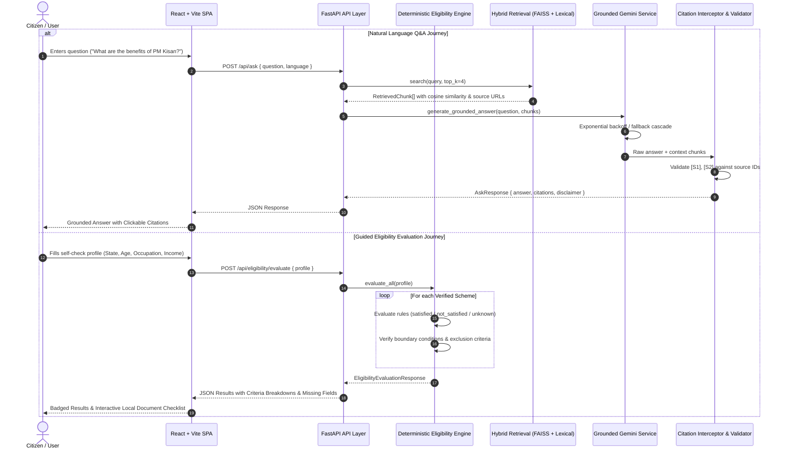

# JanSahayak AI — Architecture Specification

## 1. System Overview

JanSahayak AI is an enterprise-grade, source-grounded Government Scheme Navigator designed to solve the awareness, eligibility confusion, and documentation barriers Indian citizens face when seeking statutory public welfare benefits.

Unlike typical conversational AI chatbots that hallucinate benefit entitlements, JanSahayak AI enforces strict separation between:
1. **Deterministic Eligibility Engine:** Rules are evaluated logically with 3-valued logic (`satisfied`, `not_satisfied`, `unknown`).
2. **Dense Semantic Retrieval:** Official gazette and operational guideline chunks are retrieved via FAISS using L2-normalized cosine similarity.
3. **Grounded Generation & Citation Interceptor:** LLM output is strictly bound to retrieved source context, and emitted `[S1]`, `[S2]` citation tags are validated against active records.

---

## 2. Request Journey & Dataflow Architecture

---

## 3. Core Architecture Components

### A. Ingestion & Preprocessing Pipeline (`app/ingestion/`)
- **Parsers:** Extract text from official PDFs (with scanned document/OCR warning), HTML, JSON, and text gazettes.
- **Chunker:** Paragraph-aware window sliding with 600-character segments, 120-character overlap, and SHA-256 deduplication.
- **Metadata Attachment:** Every chunk retains `scheme_id`, `scheme_name`, `category`, `source_title`, `source_url`, and `page_number`.

### B. Hybrid Retrieval Engine (`app/services/retrieval_service.py`)
- **Semantic Vector Index:** Dense 384-dimensional embeddings generated with `sentence-transformers/all-MiniLM-L6-v2`. Indexed with FAISS `IndexFlatIP` on unit-normalized vectors (exact cosine similarity).
- **Lexical Overlap Baseline:** Tokenized keyword matching with stopword filtering used as evaluation baseline and graceful zero-dependency fallback.
- **Relevance Thresholding & Deduplication:** Filters out chunks below similarity threshold and prevents result flooding from a single scheme.

### C. Deterministic 3-Valued Eligibility Engine (`app/services/eligibility_service.py`)
- Rules are defined as structured tuples: `(field, operator, expected_value, description, source_ref)`.
- Supported operators: `eq`, `lte`, `gte`, `range`, `in`, `boolean_true`, `boolean_false`.
- **Three-Valued Output:**
  - `SATISFIED`: Profile attribute meets or is within the threshold.
  - `NOT_SATISFIED`: Profile attribute violates threshold or triggers exclusion (e.g. paying income tax for PM-KISAN).
  - `UNKNOWN`: Required profile field was omitted by citizen. **Crucial rule: Missing information is never treated as passing.**

### D. Grounded Answer Generation & Citation Validation (`app/services/gemini_service.py`)
- Prompt is isolated from untrusted input with strict grounding directives.
- Multi-model fallback cascading: primary configurable model (`gemini-3.5-flash-lite` / `gemini-3.8-flash`) with exponential backoff and jitter.
- Citation validator intercepts the model's text, verifies `[S1]`, `[S2]` against actual retrieved records, strips hallucinated tags, and attaches official government portal URLs.
- **Graceful Degraded Mode:** If Google Cloud AI experiences high provider demand or network disruption, the system synthesizes a clean factual response directly from verified database passages.

### E. Modern React Frontend (`frontend/src/`)
- Built with React, TypeScript, Vite, and Tailwind CSS.
- Color palette: Accessible warm off-white, deep navy (`#1E3A8A`), deep forest green (`#065F46`), and restrained saffron accent (`#D97706`).
- Interactive document checklist saved privately in citizen's browser `localStorage`.
